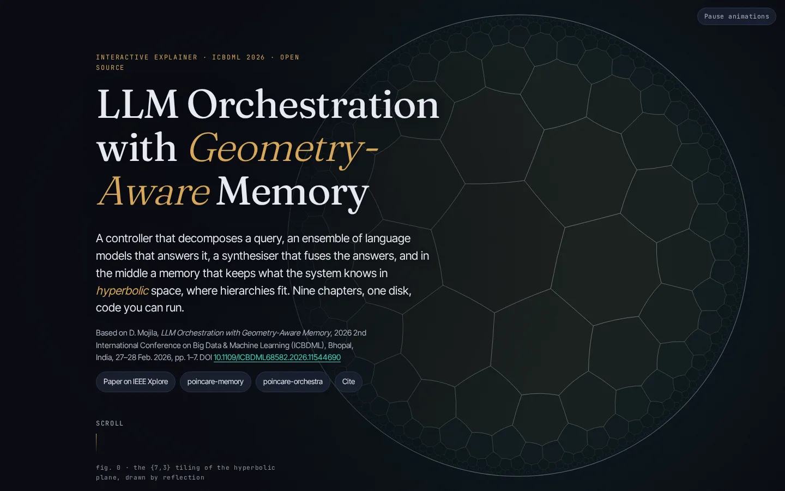

# poincare-explainer

**Live site:** https://dhruvmojila.github.io/poincare-explainer/

[](https://github.com/dhruvmojila/poincare-explainer/actions/workflows/ci.yml)
[](https://www.npmjs.com/package/poincare-ball)
[](https://doi.org/10.5281/zenodo.23551755)
[](LICENSE)
[](https://doi.org/10.1109/ICBDML68582.2026.11544690)

Interactive, open-source explainer and TypeScript reference library for

> D. Mojila, "LLM Orchestration with Geometry-Aware Memory," *2026 2nd International Conference on Big Data & Machine Learning (ICBDML)*, Bhopal, India, 27–28 Feb. 2026, pp. 1–7. DOI: [10.1109/ICBDML68582.2026.11544690](https://doi.org/10.1109/ICBDML68582.2026.11544690) · [IEEE Xplore](https://ieeexplore.ieee.org/document/11544690) · author ORCID [0009-0007-9596-7503](https://orcid.org/0009-0007-9596-7503)

The paper combines four components: a **metacognitive controller** that decomposes a query into sub-tasks (eq. 5) and allocates compute by expected information gain per cost (eq. 6); a **geometry-aware memory** that embeds hierarchical domain knowledge in the Poincaré ball (eq. 2–3), where distance from the centre encodes depth, with time-weighted embeddings and hierarchy-aware retrieval; a **provider-agnostic ensemble** with capability profiling, throttling detection and failover; and **multi-objective response synthesis** (eq. 7) with uncertainty quantification and iterative refinement. This repository explains all four in nine interactive chapters drawn in one persistent hyperbolic "world", and ships the maths as a small library.

Companion repositories: [`poincare-memory`](https://github.com/dhruvmojila/poincare-memory) (the memory, Python) and [`poincare-orchestra`](https://github.com/dhruvmojila/poincare-orchestra) (controller, ensemble and synthesis).



## Provenance

This page and the companion libraries are the author's open-source reference implementation and explanation of the method described in the paper. The system used for the paper's experiments is not released; everything here was written afterwards from the paper's description, and any numbers shown on this page come from the open-source code.

## Run it

Requires Node ≥ 20.19 (developed on Node 22) and npm.

```sh
npm install        # installs both workspaces (and Playwright for the end-to-end checks)
npm run dev        # Vite dev server for the site at http://localhost:5173
npm test           # vitest: 133 tests for poincare-ball
npm run typecheck  # tsc for the library and the site
npm run build      # builds packages/poincare-ball (tsc) then site/ (vite) into site/dist
npm run preview    # serves site/dist at http://localhost:4173
npm run e2e        # Playwright: overlap test at five viewports, console errors, screenshots (needs a build)
npm run verify     # test + typecheck + build + gzip budget (≤ 250 kB) + e2e
```

`npm run e2e` and `npm run verify` need Chromium for Playwright once: `npx playwright install chromium` (or set `PLAYWRIGHT_DIR` to a directory whose `node_modules` already contains `playwright`).

For a GitHub Pages project site set the base path and the public URL used in the canonical, Open Graph and JSON-LD tags:

```sh
BASE_PATH=/poincare-explainer/ VITE_SITE_URL=https://<user>.github.io/poincare-explainer npm run build
```

(`VITE_SITE_URL` defaults to the value in `site/.env`; change it to the real deployment URL.)

## The nine chapters

| # | Chapter | What moves |
|---|---|---|
| 00 | Hero | The {7,3} tiling of the hyperbolic plane, generated by reflection in the library, breathing under the title; scroll adds a hyperbolic parallax and dissolves it into the tree of chapter 01. |
| 01 | Flat memory forgets structure | A labelled ~200-node taxonomy drawn flat, then morphed (scroll-scrubbed) into its Sarkar layout in the disk; rings at hyperbolic radius 1–4 with 2π sinh r. |
| 02 | Flat or hyperbolic? Same tree, your query | The same tree embedded two ways with the same edge length τ: a radial tidy layout in the Euclidean plane (d3-hierarchy) beside the Sarkar layout in the disk. A query box picks a focus node by label (hashing embedder plus a substring boost); each space marks its six nearest neighbours by its own distance, teal for true relatives within two tree edges, amber for other branches, with live neighbour precision and distortion (mean \|d_embedded / (τ · d_tree) − 1\| over 400 random pairs). Nothing is scripted. Second step: the open-source benchmark bars (MAP, WordNet mammals, 1,170 nodes) with the honest reading. |
| 03 | Geometry 101 | Drag x and y: the geodesic, eq. (2) with the live metric factor at x, eq. (3) with live numbers; a point sliding outward shows depth = distance from the centre. |
| 04 | Embedding a hierarchy | Sarkar's construction on a 43-node anatomy sketch: the camera Möbius-translates a node to the origin, its children are placed at τ, and translates back. Hover for ancestors (brass) and descendants (teal); drag the disk to translate; the shell-similarity nuance of the reference implementation is stated here. |
| 05 | Time-weighted memory | Twelve timestamped memories beside their nodes fade by recency weight under three curves (half-life, Ebbinghaus, validity window), each memory with its own stability. "Ask the memory": the query and every memory (43 nodes plus the dated notes) are embedded with the reference implementation's offline hashing embedder, compared on the reference shell at the root depth, scored e^{−d} · w(Δt); the top five are listed and badged on the disk, with a shell marker at the angle of the top match (a visual proxy). "Add a note": embedded, attached under the best-matching node by name, placed one Sarkar step beyond it, ranked at once. |
| 06 | Metacognitive controller | A query splits into four sub-tasks (eq. 5) that flow as particles to specialist roles; the memory marks each sub-task's depth; allocation bars grow with G/C (eq. 6) and one sub-task is skipped for budget. |
| 07 | Ensemble and throttling | Three provider lanes with latency, length and density traces; provider-b degrades, the detector flags it (amber) from z-scores against its own baseline, and request particles fail over. |
| 08 | Synthesis | Seven synthetic candidates scored live by eq. (7): cost score against weighted quality, the Pareto front, ε floors as lines, and the chosen R* sliding along the front as the weight sliders move. |
| 09 | Cite and build | Citation with the author's ORCID, BibTeX, links, the library in nine lines, and the disk settling into its emblem. |

Design: dark "Observatory" palette (ink, brass accent, teal signal, amber alerts), Fraunces / Inter Tight / JetBrains Mono self-hosted (latin subsets), film grain at 4 %, chapter numerals and a progress rail. One canvas, one 2-D context; chapters are camera moves and crossfades inside the same world, driven by a single GSAP timeline in scroll-pixel units with `scrub: 0.6`, so nothing snaps. Each card carries its own caption and a `fig. NN` line (live where the figure changes), so no text is ever positioned over other text.

### Wide screens (≥ 820 px, and landscape phones)

Two columns: the text column on the left, the drawing region beside it, the chapter rail on the right with the current chapter's title under its numerals. The disk placement is interpolated per chapter hand-off (hero → main → split → main … → mini → emblem), never through an intermediate placement.

### Narrow portrait screens (< 820 px)

The world canvas is a pinned full-viewport stage (100svh, sized by JS). A slim 44 px top bar is part of the layout (the page is padded below it) and holds the chapter progress ("05 / 09 · Time-weighted memory", a reading-progress line) and the pause control. The drawing lives in the band below the bar; the cards scroll over the lower part of the viewport on a vertical gradient scrim (transparent over the band, ink below), each followed by a band-height gap, so the figure is clear whenever a card sits in its reading position. Chapter keyframes land exactly at each card's reading position. No popups, no hidden tabs, nothing floats over text.

## Verification

`scripts/e2e.mjs` (run by `npm run e2e` / `npm run verify`) serves `site/dist`, and at 1440×900, 768×1024, 414×896, 390×844 and 360×640 scrolls every chapter step to its reading position, asserts the card activated, and collects the bounding boxes of all visible text-bearing elements (cards, top bar, pause control, rail, hero text, footer). It fails if any two elements that are not nested intersect by more than 2 px, if any extends outside the viewport width, or if the page logs a console or page error, in normal and in reduced-motion mode; boxes are clipped to the region below the opaque mobile top bar, which the page lays out under. It also exercises the comparison query, the memory query and "add a note", and writes screenshots of every step at 1440×900 and 390×844 (plus the queries in use and a few review shots at the other viewports) to `site/screenshots/` (git-ignored build artefacts; a few curated stills live in `docs/screenshots/`). `scripts/verify.mjs` adds the gzip budget: the site must stay at or under 250 kB gzip excluding fonts.

## Structure

```
packages/poincare-ball/   npm library `poincare-ball` (ESM, TypeScript; one runtime dependency, blakejs)
  src/ball.ts             PoincareBall: project, mobiusAdd, distance (gyrovector), distanceArcosh (paper),
                          distanceToOrigin, expMap0/logMap0, expMap/logMap, geodesic, pointAt, toLorentz/fromLorentz
  src/arc.ts              geodesicArc: 2-D geodesic as a segment or a boundary-orthogonal circle (for canvas)
  src/sarkar.ts           sarkarLayout: Sarkar's construction in 2-D; placeBeyond: one Sarkar step for a new node
  src/tiling.ts           regularTiling({p,q} by reflection), reflectAcrossGeodesic, tilingCircumradius, tilingEdgeLength
  src/decay.ts            decayWeight (half-life), ebbinghausWeight, validityWindowWeight, makeDecay, weightedScore
  src/shell.ts            toShell, shellDistance, shellSimilarity: direction-only similarity on a reference shell
  src/hashing.ts          hashingEmbed: the reference implementation's offline embedder (keyed BLAKE2b, 256-d), cosine
  src/metrics.ts          indexTree (hops, within), kNearest, neighbourPrecision, distortion, randomPairs
  test/                   vitest suite (133 tests; hashing checked against test/fixtures/hashing-embedder-reference.json)
site/                     Vite + TypeScript scrollytelling site (no framework)
  index.html              all copy, Open Graph tags, Highwire citation tags, JSON-LD (ScholarlyArticle + WebPage);
                          formulas typeset at build time
  vite.config.ts          katex-prerender plugin (no KaTeX runtime in the bundle), font aliases, BASE_PATH
  src/scenes/manager.ts   one fixed canvas, presence-weighted drawing of all scenes, per-chapter disk placements,
                          narrow-portrait band layout, rAF only while needed
  src/scenes/hero.ts      {7,3} tiling, breathing camera, parallax
  src/scenes/flat.ts      01 · compare.ts 02 · geometry.ts 03 · hierarchy.ts 04 · time.ts 05 ·
  src/scenes/…            controller.ts 06 · ensemble.ts 07 · synthesis.ts 08 · cite.ts 09
  src/lib/camera.ts       Möbius camera (SU(1,1) form): focus/rotation, compose, geodesic interpolation
  src/lib/draw.ts         tokens, depth ramp, disk/geodesic/label/badge helpers
  src/lib/fig.ts          live slots in the cards' fig. lines
  src/lib/motion.ts       prefers-reduced-motion + pause toggle, Ticker (ticking numbers)
  src/lib/tree.ts         data: labelled taxonomy (~200 nodes), anatomy sketch, memories, sub-tasks, traces, candidates
  src/main.ts             scroll wiring (GSAP ScrollTrigger), reading-position anchors, hand-offs, rail and top bar
  screenshots/            Playwright screenshots written by the e2e run (git-ignored)
scripts/e2e.mjs           Playwright checks (overlaps, console errors, screenshots)
scripts/verify.mjs        test + typecheck + build + gzip budget + e2e
```

Libraries: [gsap](https://gsap.com) 3.15 + ScrollTrigger, [d3-hierarchy](https://d3js.org) (tidy tree only), [blakejs](https://www.npmjs.com/package/blakejs) (BLAKE2b for the hashing embedder), [KaTeX](https://katex.org) 0.19 at build time only, [Fontsource](https://fontsource.org) fonts, [Playwright](https://playwright.dev) 1.58 for the checks. Bundle (gzip, excluding fonts): about 78 kB JS + 9 kB CSS + 17 kB HTML.

## Library in two lines

```ts
import { PoincareBall, sarkarLayout, regularTiling, makeDecay, shellDistance, hashingEmbed } from 'poincare-ball';
const ball = new PoincareBall(1);                        // the paper's unit ball B^n
ball.distanceArcosh([0.3, 0.1], [-0.2, 0.5]);            // arcosh(1 + 2||x-y||^2 / ((1-||x||^2)(1-||y||^2)))
shellDistance(hashingEmbed('knee flexion'), hashingEmbed('knee'), 1); // a text query against a memory, direction only
```

See `packages/poincare-ball/README.md` for the full API.

## Accessibility and performance notes

Lighthouse 13.5.0, 2026-10-21, built site served statically with gzip (as GitHub Pages serves it); reproduce with `npm run lighthouse` (writes `site/lighthouse/`; `summary.json` is committed, full reports are not):

| Preset | Performance | Accessibility | Best practices | SEO | FCP | LCP | TBT | CLS |
|---|---:|---:|---:|---:|---:|---:|---:|---:|
| mobile (simulated Slow 4G, 4× CPU) | 97 | 100 | 100 | 100 | 1.7 s | 2.4 s | 10 ms | 0.001 |
| desktop | 100 | 100 | 100 | 100 | 0.4 s | 0.5 s | 0 ms | 0 |

Measured without compression (`npm run lighthouse -- --no-compression`) the mobile performance score is 86, because the uncompressed HTML, fonts and scripts take longer to arrive; every production host compresses.


- `prefers-reduced-motion` (via `gsap.matchMedia()`) and the visible "Pause animations" button switch the page to static end states with 0.4 s crossfades; particles and the breathing tiling stop.
- The canvas is redrawn only when a tween ticks or the pointer moves; a continuous loop runs only while a scene with ambient motion is on screen and the tab is visible. The CSS `vh` unit is not used; narrow screens size the stage from `100svh`.
- Every visual has a caption and a `fig.` line in its card and a hidden text description per chapter; the benchmark chart is an SVG with `<title>` and `<desc>`; colours meet 4.5:1 on their backgrounds; the query boxes, chips, sliders and buttons are ordinary form controls in DOM order (no positive `tabindex`).
- Everything (embeddings, distances, layouts, metrics) is computed in the browser; nothing leaves the page.

## Cite

```bibtex
@inproceedings{mojila2026llmorchestration,
  author    = {Mojila, Dhruv},
  title     = {{LLM} Orchestration with Geometry-Aware Memory},
  booktitle = {2026 2nd International Conference on Big Data \& Machine Learning (ICBDML)},
  year      = {2026},
  pages     = {1--7},
  publisher = {IEEE},
  address   = {Bhopal, India},
  doi       = {10.1109/ICBDML68582.2026.11544690}
}
```

The explainer and the `poincare-ball` library are archived on Zenodo under the concept DOI [10.5281/zenodo.23551755](https://doi.org/10.5281/zenodo.23551755), which always resolves to the latest release; see `CITATION.cff`.

## Licence

Apache-2.0 for all code in this repository (see `LICENSE`). The paper is © IEEE; this repository contains no text from the paper beyond its title, citation and the formulas it defines.
